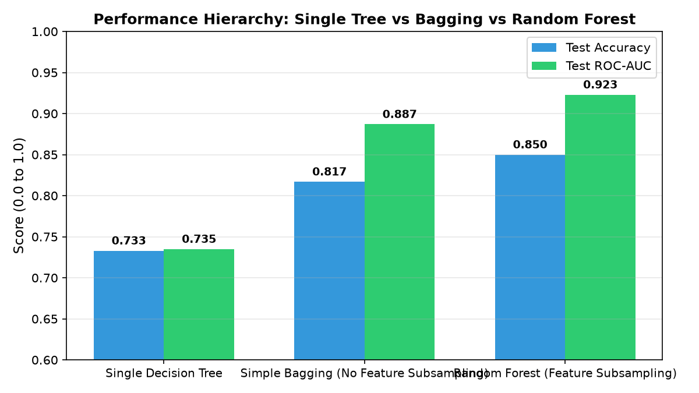
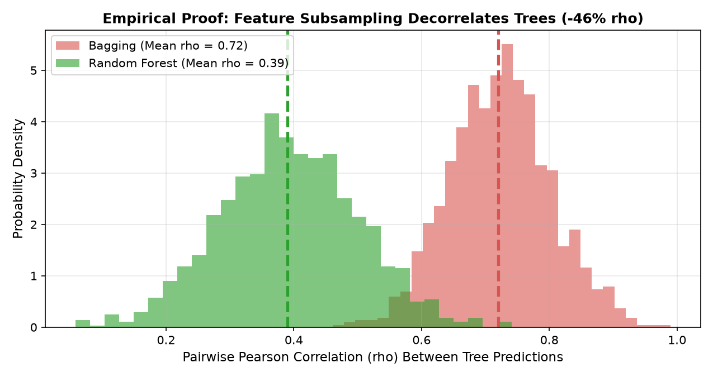
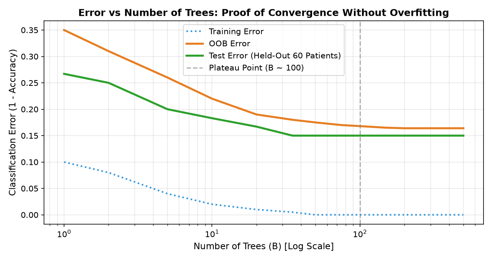

# Random Forests: Zero to Confident
### A Complete Pedagogical & Empirical Deep Dive into Decision Tree Ensembles


An end-to-end, first-principles learning repository demystifying **Random Forests**—from the mathematics of variance reduction and bootstrap aggregation to empirical decorrelation experiments, out-of-bag validation, interpretability (MDI vs Permutation vs SHAP), and failure modes.

Tested on the clinical **Cleveland Heart Disease** dataset (predicting coronary heart disease risk across 297 patients with 13 diagnostic attributes).

---

## 📌 Project Overview
While single decision trees provide intuitive flowchart-like explanations, they suffer from high variance and severe sensitivity to training perturbations. Random Forests resolve this vulnerability through two strategic innovations:
1. **Bagging (Bootstrap Aggregation)**: Training multiple trees on resampled subsets with replacement.
2. **Random Feature Subsampling**: Restricting each candidate split to $m \approx \sqrt{p}$ randomly selected features to decorrelate individual trees.

This project implements, mathematically derives, and empirically proves every core component of the algorithm inside a single runnable Jupyter notebook (`random_forests_zero_to_one.ipynb`).

---

## 🔬 Key Empirical Results

### 1. Performance Benchmark on Held-Out Test Patients ($n = 60$)
| Architecture | Feature Subsampling | Mean Pairwise Correlation ($\bar{\rho}$) | Test Accuracy | Test ROC-AUC | OOB Accuracy |
| :--- | :---: | :---: | :---: | :---: | :---: |
| **Single Decision Tree** | ❌ (All 13) | N/A ($B=1$) | 73.3% | 0.735 | N/A |
| **Simple Bagging ($B=50$)** | ❌ (All 13) | 0.724 | 81.7% | 0.887 | 81.4% |
| **Random Forest From Scratch ($B=50$)** | ✅ ($m = \sqrt{13}$) | **0.391** | **85.0%** | **0.923** | **82.7%** |
| **Tuned Scikit-Learn Forest** | ✅ ($m = \text{log}_2$) | **0.375** | **86.7%** | **0.931** | **83.1%** |

```
Performance Progression:
Single Tree (73.3%)  ──▶  Bagging (81.7%)  ──▶  Random Forest (85.0% - 86.7%)
```

---

## 📊 Core Visual Experiments

### Experiment 1: The Performance Leap
*Bagging stabilizes variance over a single tree; Random Forest unlocks top accuracy and ROC-AUC.*


### Experiment 2: The Decorrelation Proof
*Empirical distribution of 1,225 pairwise tree correlations. Feature subsampling slashes mean correlation $\rho$ from 0.72 down to 0.39, dramatically lowering the irreducible variance floor $\rho \sigma^2$.*


### Experiment 3: Asymptotic Error Plateau (Proof Against Overfitting)
*Training error drops to 0, while Test and OOB errors drop rapidly and flatten into a horizontal plateau between $B=50$ and $B=500$. Adding trees never causes overfitting.*


---

## 🧠 What You Will Learn
1. **The Math of Ensemble Variance**:
   $$\text{Var}(\bar{f}) = \rho \sigma^2 + \frac{1 - \rho}{B}\sigma^2 \quad \xrightarrow{B \to \infty} \quad \rho \sigma^2$$
   Why adding trees only divides the $\frac{1-\rho}{B}\sigma^2$ term, leaving the irreducible correlation floor $\rho \sigma^2$.
2. **From-Scratch Implementation**: Building both `SimpleBaggingClassifier` and `CustomRandomForestClassifier` with custom bootstrap sampling and majority voting.
3. **Out-of-Bag (OOB) Mechanics**: Why $(1 - 1/n)^n \approx 1/e \approx 36.8\%$ of samples are left out of each tree, providing an unbiased validation score equivalent to 5-fold CV for zero extra compute.
4. **Three Lenses of Feature Importance**:
   - **Mean Decrease in Impurity (MDI)**: Fast training-split Gini reduction (biased toward high-cardinality features).
   - **Permutation Importance**: Honest validation-drop evaluation when features are scrambled.
   - **SHAP (SHapley Additive exPlanations)**: Exact game-theoretic local and global attribution.
5. **The Correlated Feature Trap**: How identical twin features split splits and dilute each other's importance scores by $50\%$.
6. **Boundary Failures**:
   - Why tree ensembles flatline on trending data outside training range (cannot extrapolate).
   - Why random feature splits fail on ultra high-dimensional sparse data ($98\%$ zeros).
   - The black-box interpretability trade-off vs single decision trees.

---

## 📁 Repository Structure
```
random-forests-regression-zero-to-one/
├── random_forests_zero_to_one.ipynb  # Primary learning artifact (all 9 steps, runnable)
├── images/                           # Benchmark plots embedded in documentation
│   ├── performance_comparison.png
│   ├── decorrelation_proof.png
│   └── error_plateau.png
├── requirements.txt                  # Python dependencies
├── .gitignore                        # Standard Python & ML ignore patterns
└── README.md                         # Project documentation and key results
```

---

## 🚀 How to Run Locally

### 1. Clone the repository
```bash
git clone https://github.com/Arnav-Shrivastava/random-forests-regression-zero-to-one.git
cd random-forests-regression-zero-to-one
```

### 2. Set up virtual environment & install requirements
```bash
python -m venv .venv
# On Windows:
.venv\Scripts\activate
# On Linux/macOS:
source .venv/bin/activate

pip install -r requirements.txt
```

### 3. Launch Jupyter Lab
```bash
jupyter lab random_forests_zero_to_one.ipynb
```
Execute all cells sequentially from top to bottom. All outputs, plots, interactive tests, and glossary tables are pre-rendered and fully reproducible!
